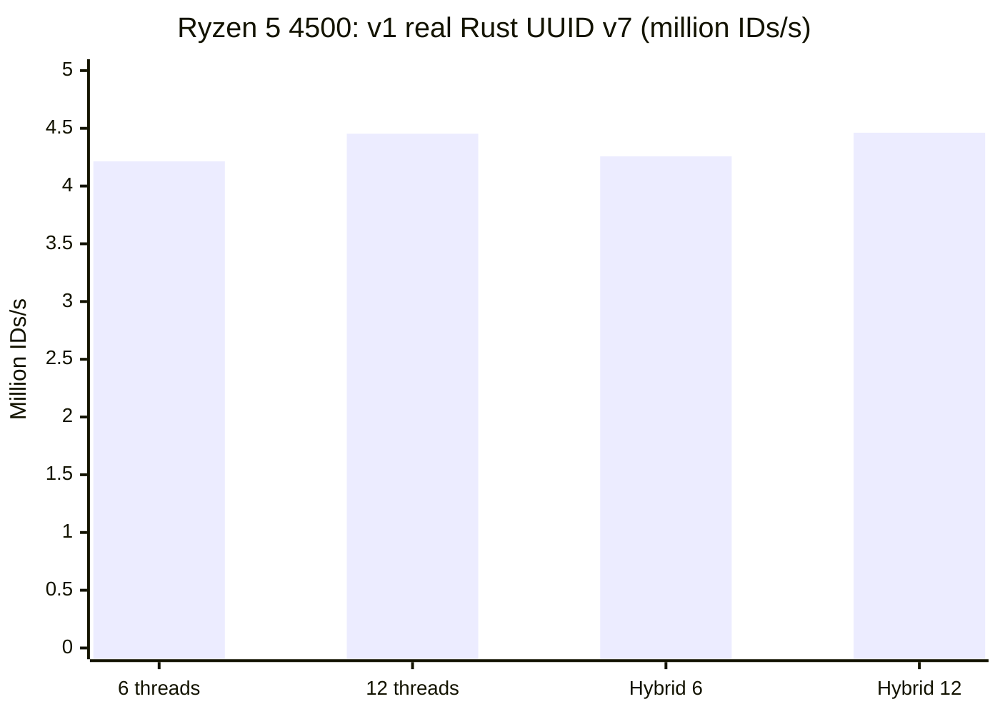
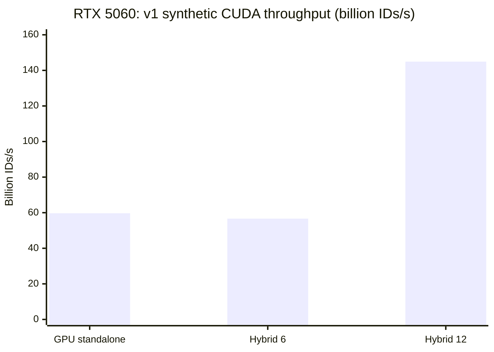

# Rust UUID v7 CPU / CUDA Benchmark

[](https://github.com/vitorhugo-dotnet/rust-uuid-v7-benchmark/actions/workflows/ci.yml)
[](https://github.com/vitorhugo-dotnet/rust-uuid-v7-benchmark/releases)

A cross-platform Rust CLI for experimenting with UUIDv7-shaped ID generation, CPU/CUDA parallelism, reproducible workloads, birthday-bound probabilities, and exact sampled collision detection.

> [!IMPORTANT]
> The **default** `splitmix` generator is a **deterministic, non-cryptographic synthetic workload**, NOT a production UUID generator. CPU and GPU now use the **same algorithm** (see `src/fair.rs` and `cuda/uuid_gpu.cu`), but their execution/measurement overheads still differ. Real UUIDv7 generation using the Rust `uuid` library is available in CPU-only mode with `--generator uuid`.

## Benchmarks on my PC (October 18, 2026)

Hardware: **AMD Ryzen 5 4500** (6 cores / 12 threads), **NVIDIA GeForce RTX 5060** (CUDA `sm_120`), **32 GB RAM**, Windows x86-64.

**Historical v1 measurements**, before implementing the shared SplitMix64 workload. CPU used `Uuid::now_v7()`, while GPU used a cuRAND Philox compute kernel with checksum reduction. **They do not measure equivalent generators and should not be interpreted as CPU/GPU speedups for the same UUID generator.** All values below are transcribed from terminal output, not extrapolated.

| Command / scenario | Throughput | Time | Count |
| --- | ---: | ---: | ---: |
| CPU (6 threads) | 4.214 million IDs/s | 10.006 s | 42,168,320 |
| CPU (12 threads) | 4.453 million IDs/s | 10.004 s | 44,546,048 |
| GPU standalone | 59.693 **billion** IDs/s | 10.000 s | 596,933,345,280 |
| GPU concurrent with 6-thread CPU | 56.648 **billion** IDs/s | 10.000 s | 566,482,698,240 |
| GPU concurrent with 12-thread CPU | 144.922 **billion** IDs/s | 10.000 s | 1,449,216,559,104 |

> The dramatic variation between runs highlights how misleading a single synthetic throughput sample can be. The CUDA throughput kernel only reduces values to a checksum; it does **not** store or verify every UUID. Collision-test performs real comparisons but has very different throughput and memory costs.

### Historical CPU measurements



### Historical GPU measurements



**New fair CPU/GPU results are pending fresh measurements on the updated code.** Please don't reuse the historical figures as a fair SplitMix64 comparison.

## Builds and prerequisites

### Windows 10/11 x86-64

- Rust stable using the MSVC toolchain: <https://rustup.rs/>
- Visual Studio 2022 Build Tools, workload **Desktop development with C++** (MSVC + Windows SDK).
- Optional GPU: NVIDIA driver and **CUDA Toolkit 12.8+** (RTX 5060: `sm_120`).

From **Developer PowerShell for VS**:

```powershell
.\build-windows.ps1
cargo test --locked
```

### Linux x86-64

Install the Rust stable toolchain and a native C/C++ toolchain. For GPU, install the NVIDIA driver and CUDA Toolkit 12.8+; a GPU is **not required to compile** the CUDA companion but is required to execute GPU workloads.

```bash
bash ./build-linux.sh
cargo test --locked
```

Both scripts compile the Rust executable even if `nvcc` is unavailable, and compile the optional `uuid-gpu[.exe]` companion when CUDA is available. CPU-only releases work without NVIDIA hardware. GPU-capable builds additionally require the appropriate CUDA runtime/driver.

### Prebuilt releases

For tags named `v*`, [GitHub Actions releases](https://github.com/vitorhugo-dotnet/rust-uuid-v7-benchmark/releases) are configured to build **Windows x64 ZIP** and **Linux x64 tar.gz** archives containing the Rust CLI and the CUDA companion executable. Publishing only occurs after **both** build jobs succeed. GitHub-hosted runners compile CUDA and test deterministic host vectors; they do not run a GPU benchmark without physical NVIDIA hardware.

## Commands

On Windows, use `.\target\release\uuid-v7-bench.exe` instead of `./target/release/uuid-v7-bench`:

```bash
# Same synthetic generator on CPU and GPU. Shared seed + fixed timestamp.
./target/release/uuid-v7-bench cpu --seconds 10 --threads 6 --seed 42 --timestamp-ms 1729280000000 --output cpu.json
./target/release/uuid-v7-bench gpu --seconds 10 --seed 42 --timestamp-ms 1729280000000 --output gpu.csv
./target/release/uuid-v7-bench hybrid --seconds 10 --threads 6 --seed 42 --timestamp-ms 1729280000000 --output hybrid.json

# CPU-only production-oriented library implementation (NOT comparable with CUDA synthetic mode).
./target/release/uuid-v7-bench cpu --seconds 10 --threads 12 --generator uuid --output library.json

# Theoretical birthday bound only; generates ZERO identifiers.
./target/release/uuid-v7-bench probability --rate 145000000000 --seconds 1200 --output probability.json

# Exact duplicate detection across samples/batches and between devices in hybrid mode.
./target/release/uuid-v7-bench collision-test --source hybrid --samples 250000 --threads 6 --output collisions.csv

# Monte Carlo across multiple sample sizes with an intentionally reduced random suffix.
./target/release/uuid-v7-bench collision-stats --volumes 1000,10000,100000 --trials 10 --entropy-bits 16 --seed 42 --timestamp-ms 1729280000000 --output statistics.json
```

The CUDA standalone executable lives beside the Rust CLI. For a host-side shared-algorithm check that **does not need a GPU**:

```bash
./target/release/uuid-gpu vectors
```

### Options

| Flag | Purpose |
| --- | --- |
| `--seconds N` | Duration for throughput modes and theoretical probability |
| `--threads N` | CPU threads |
| `--seed N` | Synthetic generator seed (default 42) |
| `--timestamp-ms N` | Fixed UUIDv7 timestamp; if omitted, current UNIX ms on launch |
| `--generator splitmix|uuid` | Synthetic default; `uuid` only supported for CPU throughput |
| `--output result.json` / `result.csv` | Machine-readable output with OS, arch, CPU model, seed, throughput, etc. |
| `--blocks N --tpb N --iterations N` | CUDA workload geometry |
| `--source cpu|gpu|hybrid` | Source selection for exact collision-test |
| `--samples N --batch N` | Samples per device (max 2 million), batch size (max 262,144) |
| `--volumes N,N,N --trials N` | Monte Carlo volumes (each max 2 million), 1–100 trials |
| `--entropy-bits 1..74` | **Artificially discard bits** to demonstrate collisions; 74 leaves layout untouched |

### What is measured?

- **CPU/GPU/hybrid**: in the default mode, both sides run the same deterministic SplitMix64-based mapping `(seed, index, timestamp) -> 128-bit v7-shaped value`, folding each value into a checksum to prevent dead-code elimination. Workload is compute-centric, not an end-to-end ID storage benchmark. CPU and CUDA runtimes have different scheduling/synchronization costs.
- **`collision-test`**: exactly compares every streamed 128-bit value in a bounded in-memory HashMap across batches, and across CPU/GPU when hybrid. CPU/GPU use disjoint seed domains to avoid trivially identical sequences. Memory usage grows with unique IDs. It is **not** the same throughput test.
- **`collision-stats`**: repeats bounded, fixed-millisecond experiments at different sample volumes and compares observed collision frequency with an ideal birthday-bound model. `--entropy-bits 16` is a **deliberate degradation**, not a weakness demonstrated in standard UUIDv7.
- **`probability`**: calculates the ideal 74-independent-random-bit-per-millisecond birthday model. SplitMix64 is deterministic, `Uuid::now_v7()` uses library-specific counters, and real UUID generators vary. This estimate is **not** an empirical collision rate or security guarantee.
- **JSON/CSV**: capture relevant test parameters and basic host metadata; GPU names are collected during CUDA benchmark runs. Benchmark hardware and CUDA driver versions should still be documented separately for rigor.

## CI / Releases

- [CI](.github/workflows/ci.yml): `cargo test --locked`, Windows/Linux release builds of the Rust CLI, and JSON/CSV smoke tests. Runs on pull requests and pushes to `main`.
- [Release](.github/workflows/release.yml): on a `v*` tag, builds the Rust CLI and CUDA companion on **both operating systems**, validates CUDA's CPU-side known vectors, and uploads the finished archives to GitHub Releases.
- Release requires CUDA Toolkit installation by GitHub-hosted runners; runner compatibility and downloads can fail independently of the Rust implementation. Validate the workflow before advertising a version as published.

To publish **after the PR is merged and CI is green**:

```bash
git checkout main
git pull --ff-only
git tag v0.2.0
git push origin v0.2.0
```

## References

- [RFC 9562 § 5.7: UUID version 7](https://www.rfc-editor.org/rfc/rfc9562.html#section-5.7)
- [Rust `uuid::Uuid::now_v7()`](https://docs.rs/uuid/latest/uuid/struct.Uuid.html#method.now_v7)
- [NVIDIA CUDA programming guide](https://docs.nvidia.com/cuda/cuda-c-programming-guide/)
- [GitHub Actions Rust documentation](https://docs.github.com/en/actions/tutorials/build-and-test-code/rust)
